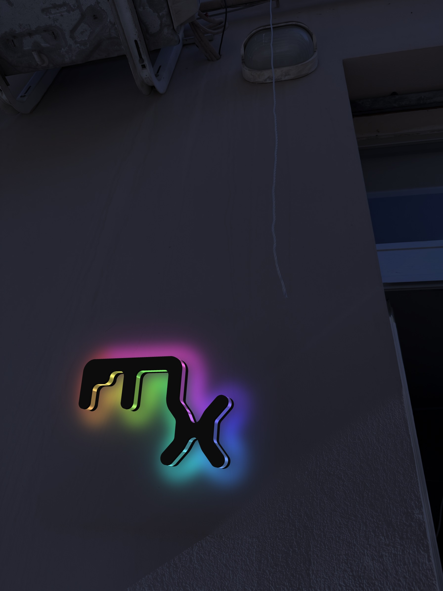
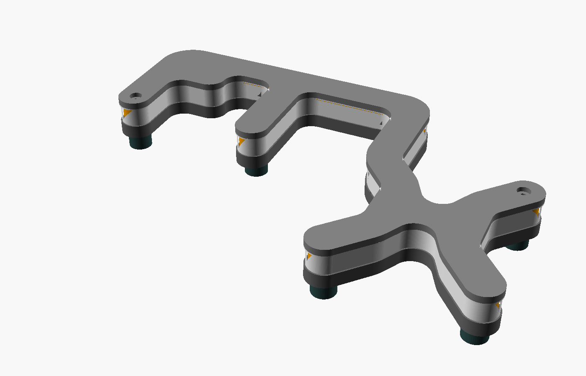

# Insegna LED MX

Logo MX da esterno, largo 260 mm e spesso 24 mm. Una striscia WS2812B corre lungo tutto il fianco e illumina il muro intorno al logo. L'insegna si fissa alle due viti già presenti nel muro, quelle che reggevano la vecchia insegna di legno (interasse 238 mm).



Questo è un fotoinserimento generato da `tools/render/` e non una foto del pezzo montato. C'è anche la versione di giorno in `docs/parete_giorno.jpg`.

## Come è fatto

Il logo è diviso in due metà, perché intero non sta sul piatto da 256 mm. Il taglio passa sulla barra alta della M, a x = 130. Ogni metà è composta da due pezzi.

Il corpo si stampa con il retro sul piatto e ha sul fianco la gola in cui corre la striscia LED. I due corpi si uniscono con una coda di rondine: il destro scende dall'alto dentro il sinistro, e la colla è facoltativa.

La lastra frontale è una piastra nera da 4 mm, stampata con il fronte sul piatto. Sotto la piastra c'è una parte bianca stampata insieme a lei, in multicolore: il labbro anteriore e una parete da 0,8 mm che scende nella gola davanti alla striscia e fa da diffusore. La giunta tra le due lastre è spostata di 15 mm rispetto a quella dei corpi, così le due giunte non si sovrappongono.

Le lastre si centrano sui corpi con 8 spine da 3,9 × 6 mm, stampate sdraiate e incollate nei fori della lastra. Al loro posto vanno bene anche spine d'acciaio da 4 × 6. Tra i pezzi non ci sono viti: le due viti a muro entrano dal fronte e la loro testa preme sulla lastra, stringendo contro il muro lastra, corpo e distanziali. Quando si svitano, la lastra si sfila e si può cambiare la striscia.

Dietro al logo ci sono 7 distanziali da 10 mm. I due forati sono quelli delle viti, mentre gli altri cinque entrano a pressione nel retro e tengono il logo parallelo al muro. Le teste delle viti si coprono con due tappini neri da 0,8 mm incollati col silicone.

Il controller (SP530E) sta fuori dal logo. Il cavo arriva dall'alto ed entra da una tacca sul bordo superiore, nel punto in cui la striscia inizia e finisce.



## Stato del progetto

I corpi sono già stampati, in PLA come prova, e hanno la striscia montata. Le lastre con il diffusore integrato invece non sono ancora state stampate né provate. Siccome l'insegna sta fuori, i pezzi definitivi vanno stampati in ASA.

Visto che i corpi esistono già, in `cad/mx_led.scad` non vanno cambiati i parametri della gola (`strip_type`, `lip_d`, `lip_t`, `diff_back`, `diff_clear`, `back_wall`), quelli dei fori per le spine, della coda di rondine e delle viti. Se cambiano, le lastre nuove non combaciano più con i corpi stampati. Anche `logo_width` deve restare 260, perché le posizioni delle viti in `wall_screws` sono calcolate per quella larghezza.

## Materiale

Per montare l'insegna, oltre ai pezzi stampati, serve questo:

- circa 1,09 m di striscia WS2812B ECO a 60 LED/m, cioè 65 LED. La versione prevista è la IP67 senza adesivo (12 × 3,85 mm), con ordine dei colori GRB;
- un controller SP530E;
- due viti da 3 mm con testa da 7 mm, lunghe circa 60 mm: dalla testa al muro attraversano 31 mm di plastica;
- un po' di silicone per i tappini e, se si vuole, colla per le spine e la coda di rondine.

## Cartelle

```
cad/        mx_led.scad (il modello), logo_pts.scad (contorno del logo, generato), MX_black.svg (logo di partenza)
export/     file pronti: stl/ per i pezzi, obj/ per le lastre multicolore, dima/ per la dima delle viti
slicer/     preset di processo OrcaSlicer usato per le lastre
tools/      script Python che generano logo_pts.scad, gli OBJ, la dima e i render
docs/       immagini usate in questo README
```

## Stampa

La stampante è una Elegoo Centauri Carbon 2 con piatto da 256 × 256 mm, lo slicer è OrcaSlicer. Ogni file STL in `export/stl/` è già orientato per la stampa.

| File | Pezzo |
|---|---|
| `mx_core_left.stl`, `mx_core_right.stl` | i due corpi, neri, col retro sul piatto |
| `mx_plate_*.stl`, `mx_plate_*_white.stl` | parte nera e parte bianca delle lastre, con le stesse coordinate |
| `mx_pins.stl` | 10 spine di centraggio (ne servono 8) |
| `mx_cap.stl` | 4 tappini per le viti (ne servono 2) |
| `mx_spacers.stl` | i 7 distanziali |
| `mx_test_core.stl`, `mx_test_plate*.stl` | pezzo di prova: la fine della gamba sinistra della M, con un foro vite e una spina |

Per le lastre conviene caricare gli OBJ in `export/obj/` invece degli STL. `mx_lastre_diffusore.obj` mette entrambe le lastre sullo stesso piatto, mentre `mx_lastra_destra.obj` e `mx_lastra_sinistra.obj` ne contengono una ciascuno. In tutti e tre la parte nera e quella bianca sono oggetti separati, e il colore è indicato sia nel file `.mtl` sia sui vertici, così OrcaSlicer può proporre da solo l'abbinamento con i filamenti.

Il preset `slicer/MX logo lastre @Elegoo CC2 0.4.json` parte dal profilo 0.20mm Standard della CC2 e aggiunge 4 pareti con generatore arachne, 5 strati pieni sopra e sotto, gyroid al 25%, la parete esterna a 60 mm/s e la prime tower. Per usarlo va copiato nella cartella `user/default/process/` della configurazione di OrcaSlicer.

## Montaggio

1. Stampa `export/dima/dima_viti.pdf` su un foglio A3 al 100%, senza adattare alla pagina, e controlla che la barra di riferimento misuri 100 mm. Appoggiata al muro, la dima mostra se le viti esistenti cadono nei punti giusti.
2. Infila la striscia nella gola dei corpi partendo dalla tacca in alto, fai tutto il giro del contorno e torna alla tacca.
3. Incolla le spine nei fori delle lastre.
4. Appoggia le lastre sui corpi: la parete bianca entra nella gola, davanti alla striscia e dietro al labbro del corpo.
5. Metti i distanziali sul retro, avvita le due viti dal fronte e copri le teste con i tappini.

## Rigenerare i file

Servono OpenSCAD (il progetto usa la 2021.01) e Python 3. La dima PDF e i render hanno bisogno anche di Pillow e numpy: il Makefile li fa girare con `uv run`, quindi non c'è niente da installare a mano. Se `uv` non c'è, si può passare un altro interprete con `make PY=python3 dima`.

```
make stl                            tutti gli STL
make export/stl/mx_plate_left.stl   un pezzo solo
make obj                            gli OBJ multicolore delle lastre
make dima                           la dima A3 delle viti
make logo                           rigenera cad/logo_pts.scad da cad/MX_black.svg
make render                         i fotoinserimenti, in tools/render/out/
```

`make stl` rigenera ogni STL più vecchio di `mx_led.scad`. Dopo un `git clone` le date dei file non corrispondono alle modifiche vere, quindi make potrebbe voler rifare tutto, e con CGAL i corpi richiedono parecchi minuti. Conviene chiedere solo i pezzi che servono. Va tenuto presente anche che OpenSCAD non scrive i triangoli sempre nello stesso ordine: uno STL rigenerato può risultare modificato in git anche quando la geometria è identica.

`cad/logo_pts.scad` è generato da `tools/svg2pts.py` e non va modificato a mano.

Per i render, `tools/render/foto_muro.jpg` è l'immagine del muro e `tools/render/H.json` è l'omografia che collega il piano del logo a quell'immagine. L'ha calcolata `fit.py` partendo dai punti indicati a mano sulla vecchia insegna di legno. Va ricalcolata solo se si cambia foto. Le immagini in `docs/` sono copie scelte tra quelle che produce `make render`.
